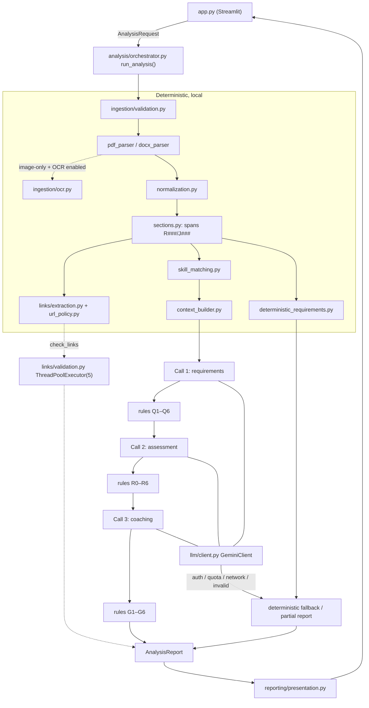

# Architecture

Artifact B. The authoritative specification is
[ai_career_coach_problem_statement_and_engineering_spec.md](ai_career_coach_problem_statement_and_engineering_spec.md);
this file mirrors the key diagrams and records verified library facts and deviations.

## Style

A **modular monolith** in a single Streamlit process. `app.py` is the only Streamlit importer; it builds an
`AnalysisRequest` and calls `career_coach.analysis.orchestrator.run_analysis(...)`. Everything below the
orchestrator is plain Python and is tested headless. The workflow is fixed (not an agent): deterministic
ingestion → deterministic analysis → three LLM calls → deterministic rules → report.

## Import rules (enforced by `tests/unit/test_architecture.py`)

- Dependency direction: `app.py` → `analysis.orchestrator` → {`ingestion`, `links`, `analysis.*`, `llm`} →
  `models`, `config`, `errors`, `utils`.
- `models/` imports only pydantic, stdlib and other `models` modules.
- Only `llm/client.py` imports `google.genai`. `pymupdf` only in `ingestion/`; `docx` only in `docx_parser.py`.
- `llm/` never imports `ingestion/`. Nothing under `src/` imports `streamlit`.

## LLM boundaries

The model receives only: JD spans, prioritized resume spans (contact section excluded, emails/phones masked),
validated requirements, taxonomy hints, validated assessments and user preferences (call 3 only). It never
receives file bytes, file names, metadata, link-check results or keys, and never decides validity, span IDs,
coverage counts or whether its own output is accepted.

## Verified SDK / library facts (M2/M4)

Verified against the installed versions on 2026-10-18:

| Library | Version | Fact |
|---|---|---|
| google-genai | 2.31.0 | `types.GenerateContentConfig` has `response_json_schema`; `types.HttpOptions.timeout` is in **milliseconds**; `types.HttpRetryOptions(attempts=1)` disables SDK retries so the application owns the retry policy. |
| google-genai | 2.31.0 | `errors.ClientError` / `errors.ServerError` (subclasses of `APIError`) expose `.code`, `.status`, `.message`, `.details` (the full error JSON; `RetryInfo.retryDelay` is read from `details["error"]["details"]`). |
| PyMuPDF | 1.28.2 | `Page.find_tables()`, `Page.get_textpage_ocr()`, `pymupdf.LINK_URI == 2`. PyMuPDF prints an informational hint about the optional `pymupdf_layout` package; it is not used. |
| python-docx | 1.2.0 | `Document.iter_inner_content()` and `Paragraph.hyperlinks` are available. |
| Streamlit | 1.66.0 | `st.status`, `streamlit.testing.v1.AppTest`, `st.dataframe(width="stretch")`. |

## Deviations from specification

| # | Spec | Implementation | Reason |
|---|---|---|---|
| D1 | `extract_links(doc: ParsedDocument, structural)` | `extract_links(spans, structural)` | Links are part of `ParsedDocument`, so they must be computed before the document is constructed. |
| D2 | DOCX: any heading-styled paragraph is a heading candidate | Heading style **and** a lexicon match start a section (detection `style`); heading-styled paragraphs that do not match the lexicon (e.g. job titles styled as Heading 2) stay as content | Prevents job-title subheadings from fragmenting the Experience section. |
| D3 | PDF text blocks split only on bullet glyphs | Lines that match the section lexicon are also split out of merged PyMuPDF blocks; `·` (U+00B7) is treated as a bullet glyph | PyMuPDF often merges a heading with the following lines into one block. |
| D4 | Q2 quote verification | Empty quotes fail verification | An empty quote cannot be verified. |
| D5 | R4 missing assessment method | `semantic_llm` with `rule_adjustments=["R4"]` | The enum has no "not assessed" value; the rule tag makes it explicit in the UI. |
| D6 | R6 phrase list | Also rewrites "you lack / you do not have" | Narrative is often second person; AC-13 forbids lack-of-skill language anywhere. |
| D7 | Wire schema descriptions | Enum fields reference `$defs` (pydantic default) | Gemini accepts `$ref`/`$defs`; the contract test forbids `anyOf`/`oneOf` and recursive refs. |
| D8 | `max_llm_attempts_per_analysis` | Exposed as `Settings.max_llm_attempts_per_analysis` (default 8), not an env var | Matches the spec's hard ceiling without adding configuration surface. |
| D9 | Ruff line length 110 | `llm/prompts.py` is exempt from E501 | Prompt text is kept verbatim from Appendix A. |
| D10 | Data-block delimiters | `<` and `>` inside JSON lines are escaped as `\u003c` / `\u003e` | Prevents document text from forging `<<<NAME` / `NAME>>>` delimiters. |
| D11 | OCR available when `tesseract` is on `PATH` or `TESSDATA_PREFIX` is set | `ingestion/ocr.py::find_tessdata()` also checks the default Windows install folders (`%ProgramFiles%\Tesseract-OCR`, `%LOCALAPPDATA%\Programs\Tesseract-OCR`) for `tessdata/eng.traineddata` and passes the folder to `get_textpage_ocr(tessdata=...)` | The UB-Mannheim Windows installer does not add Tesseract to `PATH`; PyMuPDF's bundled OCR engine only needs the language data folder. |

## Operational notes (verified 2026-10-25)

- `gemini-3.8-flash` (default) intermittently returned 503 "high demand" / 504 and took 50–100 s per call
  because of long thinking traces, which exhausted the 180 s LLM budget and produced partial reports.
  `gemini-3.6-flash` completed the same three-call analysis in ≈ 60–80 s. Switch `GEMINI_MODEL` when this happens;
  the app never switches models silently.
- `gemini-2.5-flash` returns 404 for new API keys and is no longer a suggested fallback.
- Thinking level `MINIMAL` is rejected (400) by `gemini-3.8-flash`; no thinking configuration is sent by the client.
- `streamlit.testing.v1.AppTest` creates an asyncio event loop whose self-pipe uses a loopback socket pair; in
  sandboxes that block local networking `tests/integration/test_app_smoke.py` hangs rather than fails.

## Known residual risks

- DNS rebinding in link checks (time-of-check/time-of-use). Checks are opt-in, off by default, limited to ports
  80/443, use HEAD/no-body requests and re-validate every redirect. **Not production-safe**; see spec 15.3.
- Hidden PDF text (white text) is extracted like visible text; the injection heuristic only raises a warning.
